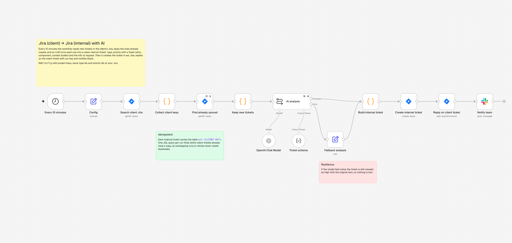

# 01 · Jira (client) → Jira (internal) sync with AI

Utility clients report incidents in **their own Jira**. Someone on the support team used to read each one, rewrite it, decide type and priority, and copy it by hand into the internal service desk. This workflow does it automatically every 10 minutes.



## Flow

1. **Every 10 minutes** the workflow searches the client Jira: `project = SOPORTE AND created >= -15m`.
2. **Find already synced**: a single JQL query on the internal Jira looks for the label `ext-<CLIENT-KEY>`, so tickets copied in a previous run are skipped. The sync is idempotent: overlapping runs never create duplicates.
3. **AI analysis** (LLM Chain + Structured Output Parser) turns the client's text into:
   - a clear title (max 80 characters)
   - `issue_type`: incident, service request, question or change
   - `priority` with a fixed rubric (the client's priority is a hint, not the answer)
   - `component`: Pagos, Facturación, Oficina Virtual, App, Chatbot, Integraciones, Backoffice
   - 3 to 5 context bullets and the information to request from the client
4. **Fallback analysis**: if the model fails twice, the ticket is still created as High with the original text.
5. **Build internal ticket** (Code): summary `CLIENT-KEY | title`, Jira wiki markup description with a link to the original ticket, labels for traceability, and priority and issue type IDs from `Config`.
6. **Create internal ticket** in the service desk project.
7. **Reply on client ticket** with the internal key, the priority and the information still needed.
8. **Notify team** on Slack, with an alert icon for Highest/High.

## Example

Client ticket `SOPORTE-201` (client priority: *Media*):

> Desde las 9:15 ningún cliente puede pagar con tarjeta en la oficina virtual. Aparece 'Error al generar la intención de pago'. Tenemos más de 200 reclamos en el call center. Por la app sí funciona.

Internal ticket created:

```
SOPORTE-201 | Falla el pago con tarjeta en la oficina virtual para todos los clientes
Type: incident · Priority: Highest · Labels: ext-SOPORTE-201, cliente-externo, pagos

h3. Contexto
* Ningún cliente puede pagar con tarjeta en la oficina virtual desde las 9:15
* Error mostrado: 'Error al generar la intención de pago'
* Más de 200 reclamos en el call center
* En la app el pago funciona

h3. Información a pedir al cliente
* Números de cuenta de ejemplo
* Captura del error
```

Comment posted on the client ticket:

> Recibimos el incidente. Lo estamos siguiendo en nuestro ticket SD-9101 con prioridad Highest.
> Para avanzar necesitamos: números de cuenta de ejemplo, captura del error.

The AI raised the priority from *Media* to *Highest* because a core payment flow is down for many users.

## Setup

1. Create two **Jira Software Cloud** credentials: one for the client's site and one for yours. Each needs an email and an API token.
2. In `Config`, set:
   - the client project key
   - the internal project ID
   - the issue type IDs and priority IDs of your Jira (*Settings → Issues*)
   - the Slack channel
3. Publish the workflow.
