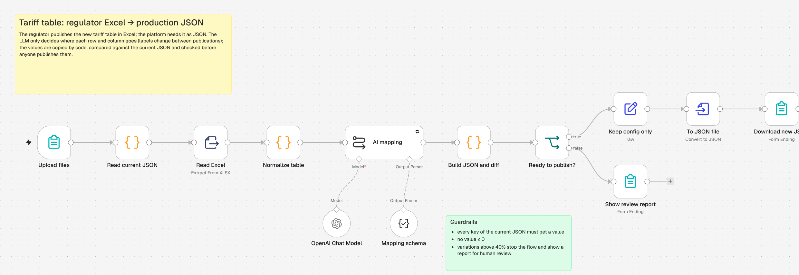
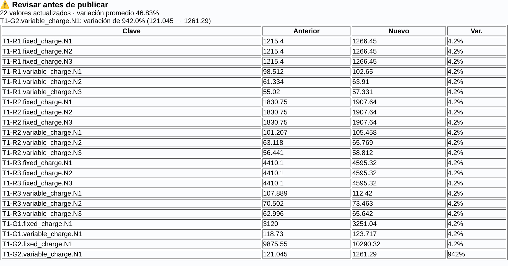

# 02 · Tariff table: regulator Excel → production JSON

Every time the energy regulator publishes a new resolution, the electricity tariff table arrives as an **Excel file**. The billing simulator and the customer portal read it from a **JSON configuration**. Updating it by hand means copying dozens of values across tariffs, charges and subsidy levels, and one typo reaches every customer.

This workflow generates the new JSON from the Excel and compares it with the current one. If anything looks wrong, it stops and shows a report instead of the file.

## Flow

1. **Upload files** (n8n form): the regulator's Excel, the current JSON, the resolution number and the effective date.
2. **Read current JSON**: it is the template, and its keys define what must be filled.
3. **Read Excel** and **Normalize table**: the table starts after title rows and repeats the tariff name only on its first row, like real publications. The code fills down the tariff name, parses numbers and lists the value columns.
4. **AI mapping** (LLM + JSON schema). The model only decides **where each value goes**:
   - row `"T1 - R2 Residencial (151 a 300 kWh/mes) | Cargo Variable"` → `T1-R2.variable_charge`
   - column `"Nivel 2 - Menores ingresos"` → `N2`

   Labels change between publications, which is what breaks fixed parsers. The model never reads or writes numbers.
5. **Build JSON and diff** (Code) copies the values, updates the resolution and date, and compares every key with the current JSON:
   - every key of the current JSON must receive a value
   - no value ≤ 0
   - any variation above 40% is flagged
6. **Ready to publish?**
   - Yes: the new JSON is downloaded.
   - No: the form shows a review report with each change and the reason it was stopped.

## Try it

Publish the workflow, open the form URL and upload the files in [`samples/`](samples) with `cuadro_tarifario_vigente.json` as the current JSON:

| Excel | Result |
| --- | --- |
| `resolucion_ER_123_2026.xlsx` | Downloads `cuadro_tarifario_ER_123_2026.json`: 22 values updated, +4.2% each |
| `resolucion_ER_124_2026_con_error.xlsx` | Stops: `T1-G2.variable_charge.N1: variación de 942.0% (121.045 → 1261.29)`. Someone typed the value ×10. |

The regulator, resolutions and values are fictional. They are generated with [`tools/make_tariff_samples.py`](../tools/make_tariff_samples.py).

## Why split AI and code this way

Reading labels that change from one publication to the next is a language problem, so the LLM handles it well. Copying numbers is not, and it is where one mistake becomes a billing incident. Here the model maps, code copies, and a person approves anything unusual.
