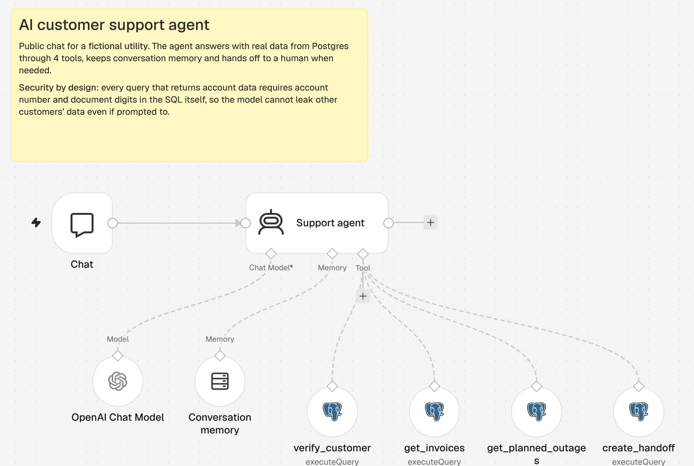

# 03 · AI Support Agent for a utility

A public chat assistant, "Volti", for the fictional utility VoltaSur Energía. It answers customers with **live data from Postgres** instead of generic text, and hands off to a human when it should.



## What it can do

| Tool | Purpose | Requires identity check |
| --- | --- | --- |
| `verify_customer` | Validates account number + last 4 digits of the holder's document | — |
| `get_invoices` | Last 6 invoices: period, due date, kWh, total, status | Yes |
| `get_planned_outages` | Upcoming planned outages by zone | No (public data) |
| `create_handoff` | Opens a request for a human agent and returns its id | No |

The agent keeps the last 12 messages as memory, answers in the customer's language, and follows rules in the system prompt: never invent amounts, escalate safety risks immediately, hand off after two failed attempts.

## Security by design

Prompt rules are not enough to protect customer data: a user can try to talk the model into querying another account. Here the protection is in the SQL itself:

```sql
SELECT i.invoice_number, i.period, i.due_date, i.consumption_kwh, i.total, i.status
FROM invoices i
JOIN customers c ON c.account_number = i.account_number
WHERE i.account_number = $1 AND c.document_last4 = $2
```

Without both values the query returns nothing, whatever the model decides. All values are passed as query parameters, never concatenated into SQL.

## Try it

Publish the workflow and open the chat URL shown in the **Chat** node.

| Message | Expected behavior |
| --- | --- |
| "Quiero ver mi factura" | Asks for account number and document digits |
| "Cuenta 100200300, documento 4821, mis facturas" | Lists invoices; October 2026 is pending |
| "Cuenta 100200300, documento 9999, mis facturas" | Verification fails, no data shown |
| "¿Hay cortes programados en zona norte?" | Lists the planned outage for NORTE |
| "Me cobraron dos veces, quiero hablar con una persona" | Creates a handoff and shares its number |

Demo accounts are in [`db/init.sql`](../db/init.sql).
